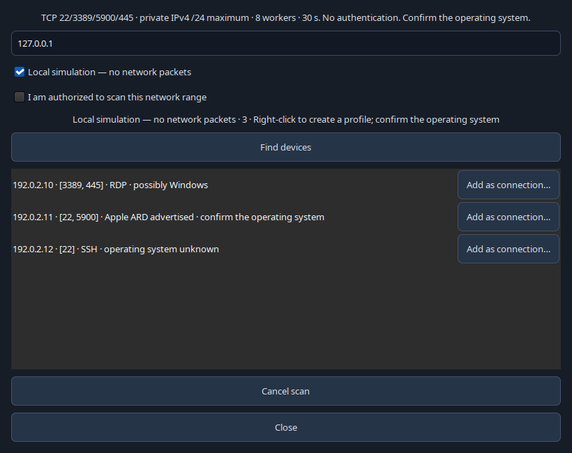
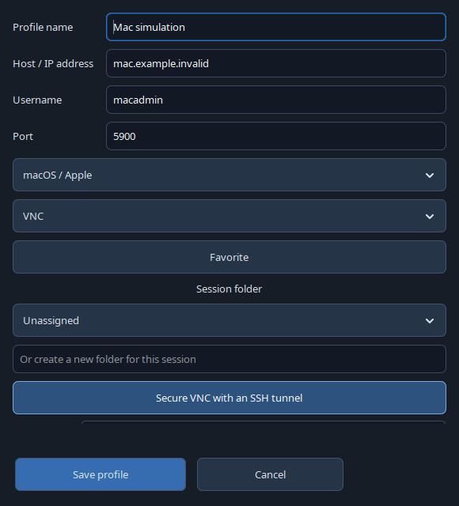

# RustRemote

A native **Rust / GTK4** remote session manager for Linux: tabbed SSH terminals,
a graphical SFTP browser, saved sessions, and RDP, VNC and serial connections.

**Preview software. English is the default; French is available in Settings
(restart required).** Developed independently, without proprietary MobaXterm code.

[Download v0.9.0](https://github.com/aurelson101/rustremote/releases/tag/v0.9.0) ·
[Validation](docs/VALIDATION-0.9.0.md) · [Roadmap](docs/ROADMAP.md) ·
[Security](docs/SECURITY.md) · [License](LICENSE)

## Screenshots

These are real application windows from an isolated local test lab. No production
server, personal credentials or customer files are shown. Remote terminal output
and user-defined names retain their original language.

### SSH terminal and session folders


### Graphical SFTP transfers and remote editing


### Windows / RDP session settings


### Application settings and language selection


### Desktop and client diagnostics


## Features

- **SSH:** integrated VTE/OpenSSH tabs, keys, SSH Agent or profile passwords,
  strict host key checks, resizing, zoom and controlled copy/paste.
- **SFTP:** local/remote panes, multiple files and recursive folders, upload/download
  buttons, drag local files into the remote pane, double-click navigation, context
  menus, remote UTF-8 editor, conflict detection, rename, permissions and deletion.
  Search both panes, toggle hidden files, folders-first sorting. Changing a filter
  clears selections to avoid transferring hidden rows; a local refresh preserves
  the remote selection. Progress, cancellation and verified file resume;
  HostName and ProxyJump support. Single-click folders to enter; Ctrl/Shift retain
  multiple selection. The context menu and keyboard activation remain available.
- **Organization:** nested folders, drag sessions/folders to another folder or use
  **Move…** in the context menu. Folder moves retain their descendants. Import/export
  uses RustRemote JSON; optional age encryption protects profile metadata.
- **Credentials:** passwords belong to their SSH/RDP profile and may be saved in the
  system Secret Service vault. Passwords and private keys are never exported.
- **RDP:** system FreeRDP 3 client, domain, protected password input, certificate/NLA
  checks, sizing and monitor options, opt-in clipboard/audio/device redirection.
- **macOS / Apple:** Apple preset and machine icon; TigerVNC DH / Apple ARD
  account authentication (RFB type 30), restricted to SSH through the same Mac,
  with no fallback to VNC password-only or unauthenticated access. The system viewer
  prompts for the macOS account/password; these credentials are not saved by RustRemote.
- **VNC / serial:** TigerVNC with an SSH tunnel option; integrated picocom terminal.
- **Discovery:** opt-in private IPv4 (/24) and IPv6 ULA (/120) TCP discovery, cancellable and
  bounded to 8 workers per process / about 30s. Start with its offline simulation, then right-click
  a device to create an SSH/Linux, Windows/RDP, Apple/ARD or VNC profile. Choose
  an existing folder or create a nested folder, then enter your account and options
  in the regular editor. Service hints are **not confirmed OS identification**.
- **Tools:** SSH local/remote/SOCKS tunnels, reviewed macros and Multi-Exec, Ping /
  Traceroute, public key fingerprints, desktop/client information, profile directory.
- **View:** show/hide panels and bars, expand/collapse folders, session search,
  terminal focus mode, reset layout, fullscreen and zoom.

## Discover devices and save connections

Use **Tools → Discover devices…**. Simulation is enabled initially and sends no
packets. For a real scan, enter a private IPv4 CIDR (maximum /24), an IPv6 ULA range
(maximum /120), or a loopback address,
leave offline mode, and explicitly confirm authorization for that range. Editing
that range clears the authorization. Changing the range or simulation mode also
clears old results and cancels/discards an obsolete job. Public/link-local targets
are refused. IPv6 link-local addresses requiring an interface are refused. Only one real discovery scan runs at a time. The final status
distinguishes completion, cancellation and timeout, with checked/total host counts.
Ports 22/3389/5900/445 are probed; an RFB security advertisement can identify an
Apple ARD service. No credentials, remote commands or operating-system exploits
are used. SSH alone does not distinguish Linux, macOS and Windows.

Optional **Resolve DNS/mDNS names** uses `/usr/bin/getent` and the host NSS
configuration (including mDNS when configured). It can send additional resolver
queries: opt in explicitly. Up to 32 discovered devices are resolved, at most 800 ms
each within the scan budget. Names are untrusted display hints; profiles retain
the scanned IP address. It is not a DNS-SD inventory of all services.

Right-click a result or click **Add as connection…**, choose the connection type,
and fill in the account, domain/key/password options and session folder. The normal
editor can select an existing folder or create a nested one. Nothing connects
when saving. Profiles created from simulated devices remain marked as simulations.
A folder's context menu also offers **New Apple connection in this folder** and VNC.
Blank Apple SSH gateway fields use the Mac host and account entered in that editor.



## Connect to a Mac

1. On the Mac, enable **Screen Sharing** or the appropriate **Remote Management**
   permissions for your account, and **Remote Login** for SSH. See Apple's
   [Screen Sharing documentation](https://support.apple.com/en-ca/guide/mac-help/mh11848/mac).
2. Click **Apple**, enter the Mac host, account name and port **5900**. Keep the SSH
   tunnel enabled and enter the **same Mac host**, its SSH port and SSH user in the
   gateway fields below. SSH uses your agent/configuration and checks the host key.
3. Install **TigerVNC 1.14+ with DH support** on Linux. Enter your macOS account and
   password in its authentication window. RustRemote does not pass them in command
   arguments or export them. Direct Apple ARD is refused because type 30 alone
   does not authenticate the server or encrypt the entire desktop.
4. For files and a terminal, create an **SSH** profile with machine type
   **macOS / Apple**, then open SFTP. macOS Remote Login must allow that account.



This is standard-mode Apple ARD account authentication through a system viewer,
not Apple's high-performance/SRP mode or a native ARD management console. The
Linux simulator checks the handshake, account rejection and pixels; **no physical
Mac or macOS VM has been qualified**. The Apple handshake and SSH tunnel are tested
in separate local labs; a complete real-Mac end-to-end test remains pending.

## Linux compatibility

The x86_64 AppImage is built in a **pinned Debian 12 userspace**, with an audited
minimum **glibc 2.36**. It bundles GTK 4.8, VTE 0.70, protocol libraries, SVG loaders
and compatible input-method modules. Graphics drivers and their libraries come
from the host. The build does not require sudo or a Docker daemon.

| Environment | Verification |
|---|---|
| Ubuntu 26.04 / GNOME | Local protocol and graphical tests; see the validation report. |
| Debian 12 baseline | Isolated X11 startup on the actual older userspace. |
| KDE Plasma, Xfce, Cinnamon / Mint and other glibc distributions | Standard GTK/X11/Wayland integration; full desktop installations are not certified. |

This asset targets **x86_64 + glibc ≥ 2.36**, not every Linux architecture or libc.
ARM and musl-only systems need separate builds. A graphical desktop, fonts and
system protocol clients are required. The `-ABI.json` release asset records the
libraries used to build this version.

```bash
chmod +x RustRemote-0.9.0-preview-x86_64.AppImage
./RustRemote-0.9.0-preview-x86_64.AppImage
# Without FUSE:
APPIMAGE_EXTRACT_AND_RUN=1 ./RustRemote-0.9.0-preview-x86_64.AppImage
```

Protocol clients: OpenSSH, **FreeRDP 3** (`xfreerdp3` or a verified version-3
`xfreerdp`), TigerVNC and picocom. Ping/Traceroute need their system tools.
Saving passwords requires a Secret Service implementation, such as GNOME Keyring
or a compatible KWallet setup. RustRemote does not install or start system services.

## Build and verify

Source builds require Rust/Cargo with edition 2024 support, GTK ≥ 4.8 and
VTE GTK4 ≥ 0.70 development packages, OpenSSL, libssh2, pkg-config and a C compiler.

```bash
cargo build --locked --workspace --bins
cargo fmt --all -- --check
cargo check --workspace
cargo clippy --workspace --all-targets -- -D warnings
cargo test --workspace
# Portable AppImage; Python 3.11+, Cargo and unprivileged user namespaces required:
./scripts/build-appimage.sh
# Also test startup inside the older build userspace:
python3 scripts/build-portable-appimage.py --validate
```

The build downloads checksum-pinned base/toolchain inputs, vendors locked Rust
crates, and installs build dependencies only inside `.tools/portable`.
`RUSTREMOTE_NATIVE_BUILD=1 ./scripts/build-appimage.sh` creates a package for the
current build system instead of the portable baseline.

For a temporary demo: `cargo run --locked -- --demo`. `--offline` blocks actual
connections. Leaving demo mode opens personal profiles without importing examples.
Profiles live in `$XDG_CONFIG_HOME/rustremote` or `~/.config/rustremote`.
Keep the `rustremote-askpass` helper beside a manually installed executable.

## Current limits

SFTP operations default to **16 MiB, 128 entries, 8 levels and 30 seconds**;
Settings offers bounded per-transfer limits (up to 1024 MiB, 4096 entries, 32 levels,
3600 seconds). Directory listings and the text editor retain their own safety limits.
text editing is UTF-8, up to 1 MiB. File resume verifies the existing prefix;
recursive folder resume is not implemented. The persistent per-profile queue offers
pause, retry, clear completed and explicit restart after reopening. Queue metadata
is private and follows the active profile store encryption; no passwords are stored
in it. Profile renames or encryption changes do not migrate old queue files.
Interrupted uploads may leave a partial remote file. Deletion is permanent and
requires confirmation. Custom ProxyCommand is refused; bastions require a
key/agent and an already approved host key.

RDP/VNC use external clients. Windows/AD, physical printers/audio/multiple monitors,
serial hardware and long-duration memory behaviour are not fully qualified.
GTK diagnostics and tested paths are recorded in the validation report.
RustRemote is not a complete reimplementation of MobaXterm or FileZilla.

## License

**Personal and professional use is allowed; resale is prohibited.**
Original code uses the custom [RustRemote No-Resale License](LICENSE).
Separate support, training and integration services may be charged for; the
software copy and its use rights must remain free of charge. Third-party components
retain their own licenses; see [NOTICE](NOTICE) and the notices inside the AppImage.
