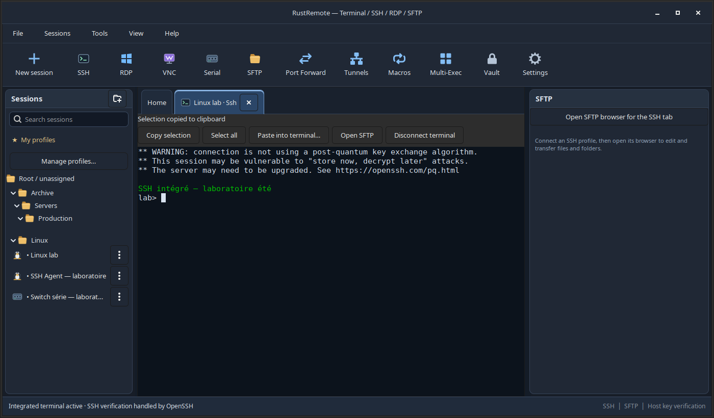
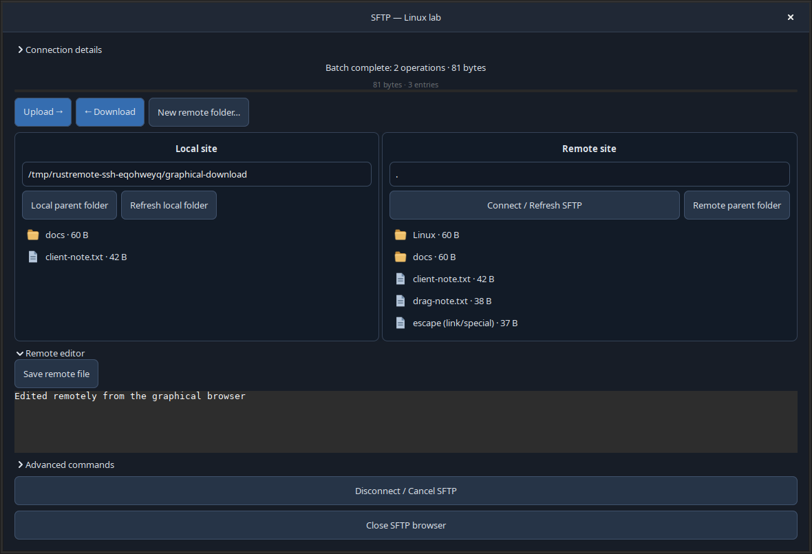
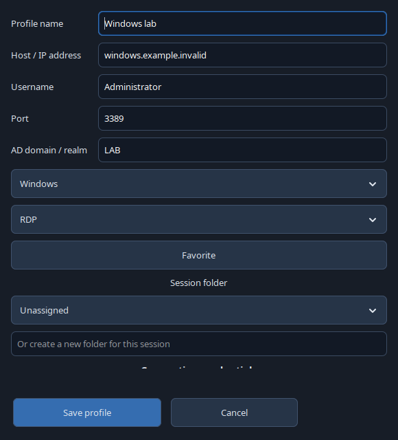
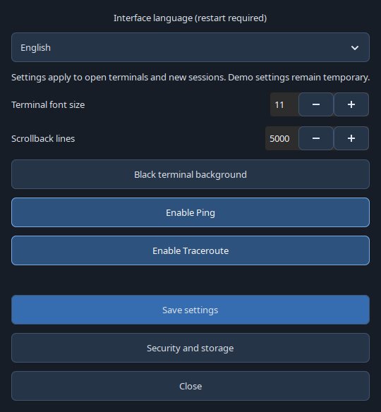
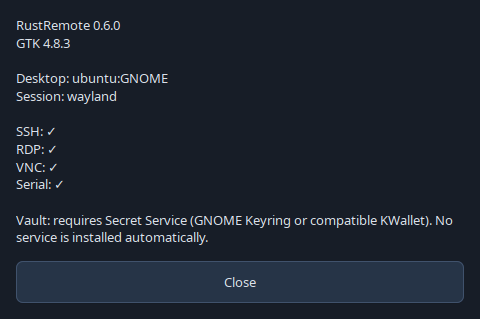

# RustRemote

A native **Rust / GTK4** remote session manager for Linux: tabbed SSH terminals,
a graphical SFTP browser, saved sessions, and RDP, VNC and serial connections.

**Preview software. English is the default; French is available in Settings
(restart required).** Developed independently, without proprietary MobaXterm code.

[Download v0.6.0](https://github.com/aurelson101/rustremote/releases/tag/v0.6.0) ·
[Validation](docs/VALIDATION-0.6.0.md) · [Roadmap](docs/ROADMAP.md) ·
[Security](docs/SECURITY.md) · [License](LICENSE)

## Screenshots

These are real application windows from an isolated local test lab. No production
server, personal credentials or customer files are shown. Remote terminal output
and user-defined names retain their original language.

### SSH terminal and session folders



### Graphical SFTP transfers and remote editing



### Windows / RDP session settings



### Application settings and language selection



### Desktop and client diagnostics



## Features

- **SSH:** integrated VTE/OpenSSH tabs, keys, SSH Agent or profile passwords,
  strict host key checks, resizing, zoom and controlled copy/paste.
- **SFTP:** local/remote panes, multiple files and recursive folders, upload/download
  buttons, drag local files into the remote pane, double-click navigation, context
  menus, remote UTF-8 editor, conflict detection, rename, permissions and deletion.
  Progress, cancellation and verified file resume; HostName and ProxyJump support.
- **Organization:** nested folders, drag sessions/folders to another folder or use
  **Move…** in the context menu. Folder moves retain their descendants. Import/export
  uses RustRemote JSON; optional age encryption protects profile metadata.
- **Credentials:** passwords belong to their SSH/RDP profile and may be saved in the
  system Secret Service vault. Passwords and private keys are never exported.
- **RDP:** system FreeRDP 3 client, domain, protected password input, certificate/NLA
  checks, sizing and monitor options, opt-in clipboard/audio/device redirection.
- **VNC / serial:** TigerVNC with an SSH tunnel option; integrated picocom terminal.
- **Tools:** SSH local/remote/SOCKS tunnels, reviewed macros and Multi-Exec, Ping /
  Traceroute, public key fingerprints, desktop/client information, profile directory.
- **View:** show/hide panels and bars, expand/collapse folders, session search,
  terminal focus mode, reset layout, fullscreen and zoom.

## Linux compatibility

The x86_64 AppImage is built in a **pinned Debian 12 userspace**, with an audited
minimum **glibc 2.36**. It bundles GTK 4.8, VTE 0.70, protocol libraries, SVG loaders
and compatible input-method modules. Graphics drivers and their libraries come
from the host. The build does not require sudo or a Docker daemon.

| Environment | Verification |
|---|---|
| Ubuntu 26.04 / GNOME | Local protocol and graphical tests; see the validation report. |
| Debian 12 baseline | Isolated X11 startup on the actual older userspace. |
| KDE Plasma, Xfce, Cinnamon / Mint and other glibc distributions | Standard GTK/X11/Wayland integration; full desktop installations are not certified. |

This asset targets **x86_64 + glibc ≥ 2.36**, not every Linux architecture or libc.
ARM and musl-only systems need separate builds. A graphical desktop, fonts and
system protocol clients are required. The `-ABI.json` release asset records the
libraries used to build this version.

```bash
chmod +x RustRemote-0.6.0-preview-x86_64.AppImage
./RustRemote-0.6.0-preview-x86_64.AppImage
# Without FUSE:
APPIMAGE_EXTRACT_AND_RUN=1 ./RustRemote-0.6.0-preview-x86_64.AppImage
```

Protocol clients: OpenSSH, **FreeRDP 3** (`xfreerdp3` or a verified version-3
`xfreerdp`), TigerVNC and picocom. Ping/Traceroute need their system tools.
Saving passwords requires a Secret Service implementation, such as GNOME Keyring
or a compatible KWallet setup. RustRemote does not install or start system services.

## Build and verify

Source builds require Rust/Cargo with edition 2024 support, GTK ≥ 4.8 and
VTE GTK4 ≥ 0.70 development packages, OpenSSL, libssh2, pkg-config and a C compiler.

```bash
cargo build --locked --workspace --bins
cargo fmt --all -- --check
cargo check --workspace
cargo clippy --workspace --all-targets -- -D warnings
cargo test --workspace
# Portable AppImage; Python 3.11+, Cargo and unprivileged user namespaces required:
./scripts/build-appimage.sh
# Also test startup inside the older build userspace:
python3 scripts/build-portable-appimage.py --validate
```

The build downloads checksum-pinned base/toolchain inputs, vendors locked Rust
crates, and installs build dependencies only inside `.tools/portable`.
`RUSTREMOTE_NATIVE_BUILD=1 ./scripts/build-appimage.sh` creates a package for the
current build system instead of the portable baseline.

For a temporary demo: `cargo run --locked -- --demo`. `--offline` blocks actual
connections. Leaving demo mode opens personal profiles without importing examples.
Profiles live in `$XDG_CONFIG_HOME/rustremote` or `~/.config/rustremote`.
Keep the `rustremote-askpass` helper beside a manually installed executable.

## Current limits

SFTP operations are bounded to **16 MiB, 128 entries, 8 levels and 30 seconds**;
text editing is UTF-8, up to 1 MiB. File resume verifies the existing prefix;
recursive folder resume and a persistent transfer queue are not implemented.
Interrupted uploads may leave a partial remote file. Deletion is permanent and
requires confirmation. Custom ProxyCommand is refused; bastions require a
key/agent and an already approved host key.

RDP/VNC use external clients. Windows/AD, physical printers/audio/multiple monitors,
serial hardware and long-duration memory behaviour are not fully qualified.
Known nonfatal GTK 4.8 focus warnings are recorded in the validation report.
RustRemote is not a complete reimplementation of MobaXterm or FileZilla.

## License

**Personal and professional use is allowed; resale is prohibited.**
Original code uses the custom [RustRemote No-Resale License](LICENSE).
Separate support, training and integration services may be charged for; the
software copy and its use rights must remain free of charge. Third-party components
retain their own licenses; see [NOTICE](NOTICE) and the notices inside the AppImage.
