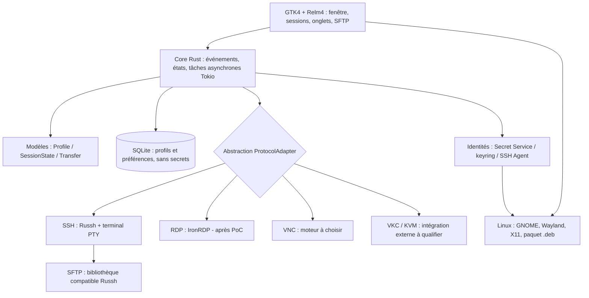
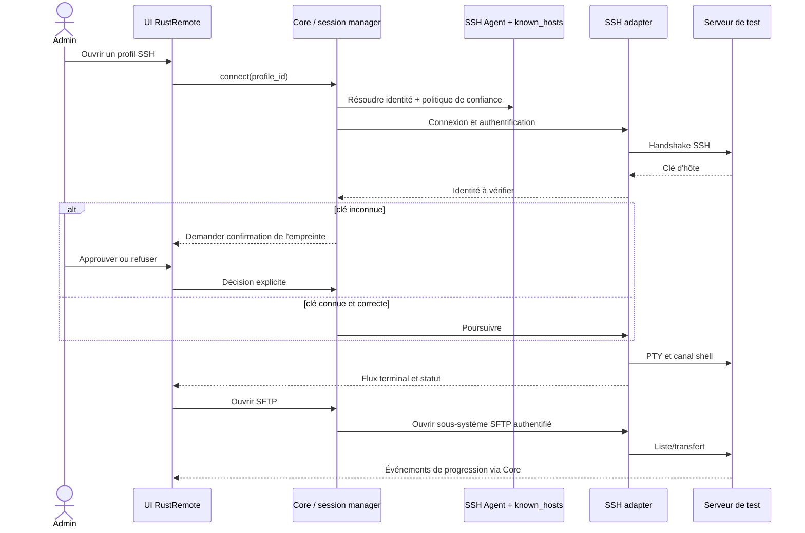

# Architecture technique cible — RustRemote

> **Cible de conception, non implémentée.** APIs, versions exactes et licences doivent être vérifiées par PoC, puis figées avec Cargo.lock.

## État implémenté — 0.4.0

`ui.rs` conserve la disposition GTK4 ; `dialogs.rs` coordonne profils/actions et
les workers I/O. `profiles.rs` valide les modèles et construit les argv sans shell ;
`store.rs` conserve le JSON privé ou chiffré age, sans mot de passe distant.
`terminal.rs` intègre VTE/OpenSSH et VTE/picocom : PTY, UTF-8/ANSI, resize,
presse-papiers contrôlé et fermeture par pidfd. `clipboard.rs` borne les lectures.
`sftp.rs` utilise ssh2/libssh2 hors GTK ; `sftp_ui.rs` fournit un navigateur par
terminal SSH, fermé avec celui-ci. Le transport est distinct d’OpenSSH et ne reprend
pas sa configuration/ProxyJump. Connexion réutilisée par navigateur, opération unique,
annulation, délais et budgets ; pas de reprise ni progression détaillée.
`preferences.rs` et `dialogs/settings.rs` gèrent les préférences non secrètes et la
sortie du laboratoire temporaire vers le magasin personnel. Chargements/écritures
atomiques passent par les workers ; les terminaux appliquent les préférences courantes.
RDP/VNC restent des clients externes. L’incrément non publié ajoute `credentials.rs`
(Secret Service/keyring), `ssh_auth.rs` et le binaire `rustremote-askpass` (socket privé)
pour OpenSSH ; `external.rs` suit FreeRDP par pidfd et transmet le secret sur stdin.
Les profils ne contiennent que des références UUID, retirées des exports et à l’import.
SQLite, Russh et IronRDP restent des cibles, pas des dépendances implémentées. Les schémas suivants décrivent
cette architecture cible. Tests réels de l’AppImage : voir VALIDATION-0.4.0.md.

## Ajout implémenté — 0.7.0

Les profils MacOs utilisent SSH/SFTP existants ou TigerVNC DH/type30 avec tunnel SSH
vers le même Mac. Pas de moteur ARD propriétaire ni de copie de MGRemote. Le client
système demande les identifiants macOS. La recherche SFTP agit sur les lignes déjà
chargées, sans requête réseau ; les workers et limites du protocole sont conservés.

## Schéma modulaire (Mermaid, éditable)



## Décomposition logique (proposition, pas de fichiers créés tant qu'inutiles)

- `app` : démarrage, événements UI, états de session et annulation des tâches.
- `ui` : composants GTK4/Relm4, panneaux, onglets, vues terminal, SFTP et notifications.
- `domain` : types typés `SessionProfile`, `Protocol`, `SessionStatus`, `TransferJob`, `HostKeyTrust` ; aucune dépendance graphique.
- `infra/storage` : SQLite, migrations, préférences, filtres ; jamais de secrets ou clés privées.
- `infra/secrets` : trousseau GNOME Secret Service, gestion de références de secrets et SSH Agent.
- `adapters/ssh` : sessions authentifiées, validation d'hôtes, port forwarding, PTY et canaux.
- `adapters/sftp` : navigation et transferts, erreurs, retry sûr, vérification des chemins.
- `adapters/rdp` : expérimentation IronRDP (sécurisation NLA/TLS, UI de rendu).
- `adapters/vnc` : moteur étudié ultérieurement, authentication et validation transport.
- `adapters/kvm` : URI ou lanceur externe si légitime, dépend du matériel/support éditeur.

**Éviter de créer 10 crates dès le départ.** Démarrer avec un seul package Cargo et des modules. Diviser en workspace seulement si la complexité le justifie.

## Contrat d'abstraction envisagé

```rust
// Pseudo-contrat, ne pas copier tel quel sans conception de l'API async.
enum ProtocolKind { Ssh, Rdp, Vnc, KvmExternal }
struct SessionProfile {
    id: String,
    label: String,
    host: String,
    port: u16,
    protocol: ProtocolKind,
    username: Option<String>,
    secret_ref: Option<String>, // référence à un trousseau, jamais un secret
}
// Trait ProtocolAdapter : connect(profile) -> Result<SessionHandle>
// SessionHandle : événements d'état et shutdown() ; sous-types spécialisés par protocole.
```

## Séquence SSH + SFTP



## Choix technologiques à valider

| Domaine | Candidat | Condition d'acceptation |
|---|---|---|
| UI | GTK4 + Relm4 | Build et rendu GNOME/Wayland, onglets, modèles de données. |
| Runtime | Tokio | Annulation propre, backpressure, pas de blocage thread UI. |
| SSH | Russh | PTY, agent, known_hosts/politique de confiance testés. |
| SFTP | Écosystème Russh | Compatibilité des versions et gestion erreurs/transferts testée. |
| Terminal | WezTerm/termwiz ou moteur Rust alternatif | Licence, intégration dans widget GTK et performance réelle étudiées. |
| RDP | IronRDP | PoC NLA/TLS, rendu UI, clipboard et politique certificats. |
| VNC | À évaluer | Encodages/authentification/Wayland, licence et suivi. |
| Stockage | SQLite (`rusqlite` ou `sqlx`) | Migrations et requêtes paramétrées ; sans secrets. |
| Secrets | Secret Service / libsecret | Aucun stockage en clair ; interface mockable pour tests. |
| Paquets | dpkg/deb, AppImage | Reproductibilité, signature et scan de dépendances. |

## Données

- Tables minimales : `profiles`, `folders`, `preferences`, `transfer_history` (métadonnées sans secrets).
- `profiles.secret_ref` contient seulement un identifiant de trousseau, jamais un secret.
- Chemins locaux autorisés, transferts conscients des liens symboliques et du risque traversal.
- Une commande peut viser plusieurs sessions uniquement après confirmation claire de la liste des cibles.

## Organisation de dépôt envisagée

```text
rustremote/
├── Cargo.toml                # après P0-02
├── Cargo.lock                # versionné pour une application
├── src/                      # création incrémentale, pas de modules vides
├── tests/                    # seulement lorsque nécessaire
├── assets/                   # image et SVG de référence
├── docs/                     # produit, architecture, feuille de route, sécurité
├── prompts/                  # prompts d'agents
├── CLAUDE.md
├── AGENTS.md
└── MEMORY.md
```

## Découverte implémentée — 0.8.0

`discovery.rs` isole la validation des plages privées, les sondes TCP/RFB bornées,
les huit workers et leur annulation. `dialogs/discovery.rs` expose les résultats et
les menus ; leur ajout passe par `editor_prefilled`, puis par la validation et le
stockage existants. Le worker réseau ne lit aucun coffre ni donnée d’authentification.
